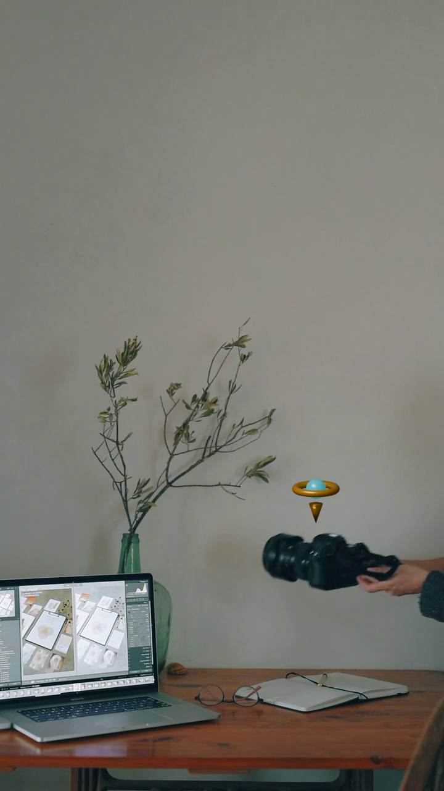
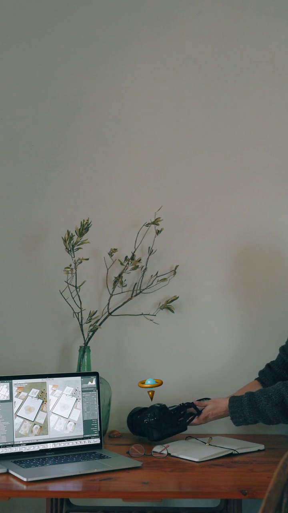
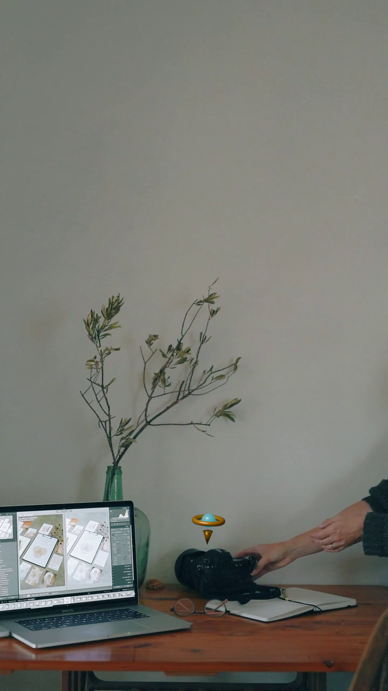

# Лабораторная работа № 2

Баранов Вадим Сергеевич · ПИН-21м · МИЭТ

## Отчёт

## Введение

Цель работы — разместить 3D-модель в видеоклипе со статичной камерой так, чтобы модель следовала за движущимся объектом. В качестве объекта выбран фотоаппарат, который перемещается по столу; видеоклип опубликован Leeloo The First на Pexels [1].

## 1 Исходные данные

Исходный вертикальный клип имеет разрешение 720×1280, частоту 29,97 кадра/с и 330 кадров. Для обработки выбран интервал кадров 85–184, на котором фотоаппарат перемещается от правой части стола к центру и затем опускается. Камера в сцене неподвижна.

Основные параметры и координаты привязки приведены в таблице 1.

Т а б л и ц а 1 - Параметры отслеживания

| Параметр | Значение |
| --- | --- |
| Разрешение | 720×1280 |
| Частота кадров | 29,97 кадра/с |
| Обрабатываемый диапазон | 85–184 |
| Количество кадров результата | 100 |
| Начальная точка привязки | (512, 865) px |
| Конечная точка привязки | (386, 1024) px |
| Точек на последнем кадре | 74 |

## 2 Методика отслеживания объекта

На первом кадре вручную ограничена область фотоаппарата и выделено 90 угловых точек. Перемещение точек рассчитано методом Lucas–Kanade [3]. Между соседними кадрами оценивалось аффинное преобразование с RANSAC, после чего преобразования накапливались. Для контроля сохранён файл tracking.csv с координатами, масштабом, углом поворота и числом точек. 3D-модель выполнена в Blender в виде светящегося кольца с центральной сферой и указателем. Прозрачный PNG накладывался поверх каждого кадра с учётом вычисленной позиции, масштаба и поворота. Этот способ учитывает преобразование в плоскости изображения; полный трёхмерный поворот и перекрытие модели рукой не восстанавливаются. Метод трёхмерной реконструкции движения объекта описан в руководстве Blender [2].

## 3 Результат совмещения

Положение модели относительно фотоаппарата в начале, середине и конце интервала показано на рисунках 1–3. Объект сохраняет привязку к фотоаппарату на всём выбранном интервале. Масштаб модели уменьшился с 1,0000 до 0,8058, угол поворота изменился от 0 до 3,44°, число отслеживаемых точек не опускалось ниже 74.



*Рисунок 1 - Начальное положение модели*

Положение модели в середине и в конце выбранного отрезка показано на рисунках 2 и 3.



*Рисунок 2 - Промежуточное положение модели*



*Рисунок 3 - Конечное положение модели*

## Заключение

Выполнена привязка 3D-модели к движущемуся фотоаппарату в видеоклипе со статичной камерой. Получены итоговый ролик, контрольные кадры, проект модели и таблица параметров трекинга.

## Список литературных источников

1. Leeloo The First. A Person Putting a Camera on the Table. Pexels. URL: https://www.pexels.com/video/a-person-putting-a-camera-on-the-table-7600541/ (дата обращения: 17.11.2026).

2. Blender Manual. Object Solver Constraint. URL: https://docs.blender.org/manual/en/5.4/animation/constraints/motion_tracking/object_solver.html (дата обращения: 17.11.2026).

3. OpenCV Documentation. Optical Flow. URL: https://docs.opencv.org/4.x/d4/dee/tutorial_optical_flow.html (дата обращения: 17.11.2026).

## Файлы и запуск

- [Итоговый видеоролик](result.mp4), [исходный клип](video_source.mp4).
- [Модель Blender](model.blend), [отрендерованная модель](model.png).
- [Данные отслеживания](tracking.csv) и [программа обработки](tracking.py).

Для повторения обработки установите Python, NumPy и OpenCV, затем запустите:

```bash
python -m pip install numpy opencv-python-headless
python tracking.py
```

Результат повторного запуска сохраняется в `result_rebuilt.mp4`. Программа отслеживает положение, масштаб и поворот объекта в плоскости изображения; полная пространственная ориентация не восстанавливается.
